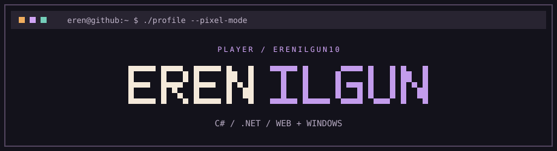

<code>eren@github:~$</code> &nbsp; <a href="https://github.com/erenilgun10?tab=repositories">projeler/</a> &nbsp; · &nbsp; <a href="#teknolojiler">stack.txt</a>

<h2><code>$ whoami</code></h2>

C# ve .NET ile servisler, Windows uygulamaları ve veri odaklı araçlar geliştiriyorum. Projelerimde API tasarımı, katmanlı yapı ve kullanımı anlaşılır ekranlar üzerine çalışıyorum.

      

<h2><code>$ ls projects/</code></h2>

<table><tr><td width="50%"><h3><a href="https://github.com/erenilgun10/NewMicroservice">NewMicroservice ↗</a></h3>
Catalog API; servis, veri ve test katmanları.

ASP.NET Core · MongoDB</td><td><h3><a href="https://github.com/erenilgun10/Inventory">Inventory ↗</a></h3>
Windows üzerinde katmanlı envanter uygulaması.

WinForms · Entity Framework Core</td></tr></table>

<h2><code>$ play galaga</code></h2>

<picture><source media="(prefers-reduced-motion: reduce)" srcset="./assets/galaga-contribution-graph-still.png"><source media="(prefers-color-scheme: dark)" srcset="./assets/galaga-contribution-graph-dark.svg"></picture>

<h2><code>$ git languages --chart</code></h2>

 

<h2><code>$ github --stats</code></h2>

<h2><code>$ unlock achievements</code></h2>

<h2><code>$ git log --recent</code></h2>

⚡ Son GitHub hareketleri
<ul><li>Profil deposunda güncelleme — <a href="https://github.com/erenilgun10/erenilgun10">erenilgun10/erenilgun10</a></li><li><a href="https://github.com/CyprusCodes/kolik-docs">CyprusCodes/kolik-docs</a> deposunu fork etti</li><li><a href="https://github.com/CyprusCodes/xest">CyprusCodes/xest</a> deposunu fork etti</li></ul>

🎧 Şu an ne dinliyorum?

Spotify bağlantısı seçildikten sonra bu alanda gösterilecek.

